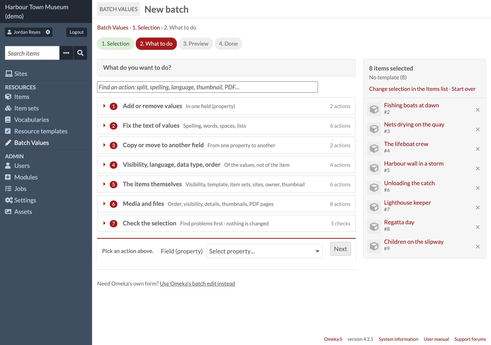
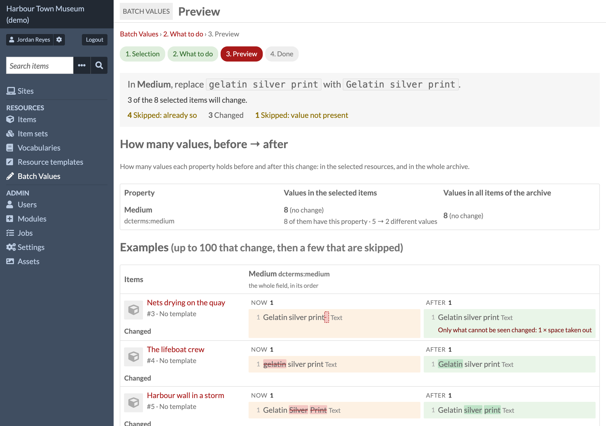
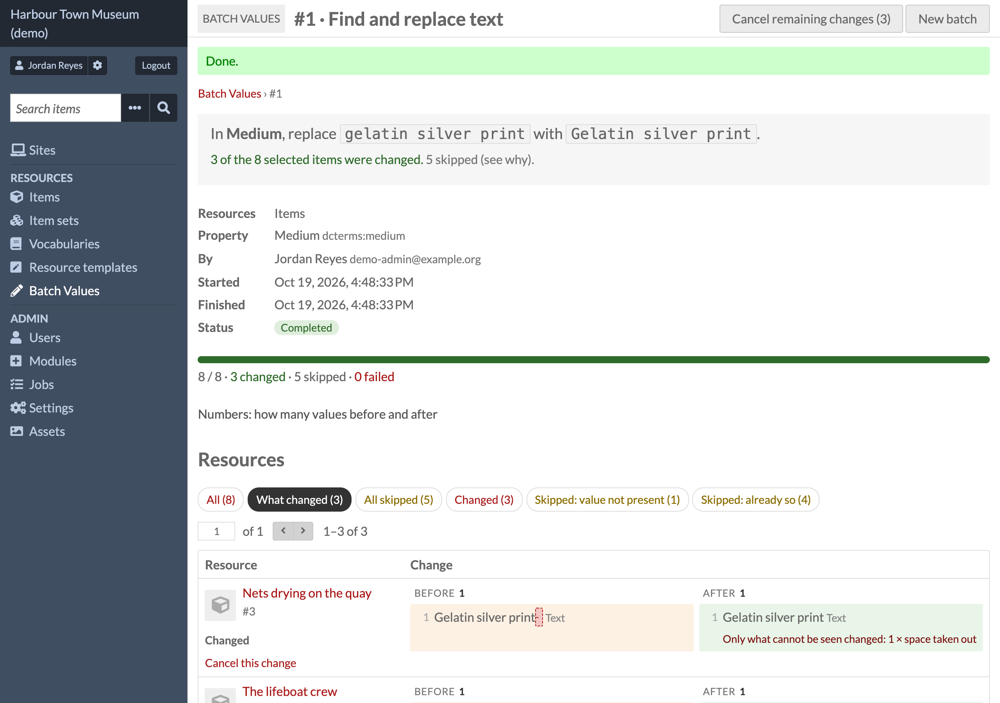

# Batch Values

**Batch Values** is an Omeka S module for bulk editing: change many items, item sets and media
at once — **add, remove, replace, find and replace, split, join and clean up values**, fill labels
and links from authority services, change visibility, language, data type, template, class,
owner, item sets, sites and thumbnails, reorder media, edit media details and make page images
from PDFs.

Every run shows a **preview** first, every change is **logged**, and almost every run can be
**cancelled** later — one change at a time or the whole run.



- Omeka S 4.x · no other module required (Value Suggest is used when it is on)
- Licence: GPL-3.0-or-later (see `LICENSE`)
- Issues and questions: https://github.com/phumraphee/BatchValues/issues

## Screenshots

**Preview** — what will change and what will be skipped, and why, before anything is written:



**The log** — every run, who made it and what it changed, with a button to cancel it:



All screenshots are from a demo site with made-up people and objects.

## Install

1. Unzip into `modules/BatchValues` (the folder name must stay exactly that).
2. Admin → Modules → **Batch Values** → Install. To update, replace the folder and press Upgrade.

Installing creates two tables, `batch_values_change_set` and `batch_values_change`.
**Uninstalling drops them, and the whole log with them.**

The task *Make page images from PDFs* needs `pdftoppm` (package poppler-utils) or ImageMagick
on the server.

## How it works

1. **Choose** — on Items, Item sets or Media, search or tick, then *Batch actions → Edit with
   Batch Values*. Ticked rows are used if any are ticked; otherwise every result of the search.
   There is also *Admin → Batch Values → New batch* (by template, item set, a list of ids or a
   search URL). Click any item in the side list to look at it without leaving the page.
2. **Choose what to do** — the tasks are grouped and can be searched by name (*Find an action*,
   e.g. `pdf`, `merge`, `trim`). Tasks a user is not allowed to do are not shown.
3. **Preview** — how many will change and how many will be skipped, and why; the field's counts
   before → after; up to 100 examples. Nothing has been written yet.
4. **Run** — small runs happen at once; larger ones become a background job (*Admin → Jobs*).
   Everything is checked again when the run starts, so an edit made in between is taken into account.

## The tasks

**Add or remove values** — Add values (with the data types of each resource template) ·
Remove values.

**Fix the text of values** — Replace whole values · Find and replace text (match case, whole
value, regular expressions with `$1`) · Add text before or after · Split into several values ·
Join values into one · Clean up spaces and duplicates · Plain text from HTML (1.1.0) · Fill from
an authority (1.1.0).
These touch text-like data types only (Text, URI, HTML, XML, Custom Vocab, Numeric, Value
Suggest); a value that links to a resource is never rewritten as text. Every new value is checked
by its data type before it is saved.

*Fill from an authority* fills the empty labels of links, sets every label to the authority's
name, or finds the link of a text (exactly one suggestion with that text, or none is taken). It
asks Value Suggest first when that module is on, with its services and settings; otherwise it
reads the link's own page, for links of id.loc.gov, wikidata.org, geonames.org, idref.fr,
vocab.getty.edu, d-nb.info (GND), orcid.org and ror.org only — no other address is opened. The
services are asked during the preview and the run writes what the preview showed; at most 200
questions per run.

**Copy or move to another field** — copy or move values to another property, all of them or the
ones that match a rule; a moved value keeps its id, visibility and annotation.

**Visibility, language, data type, order** (of values) — Make values public or private · Set,
change or remove the language (also "every value with language code X") · Change to the data
type of the template · Sort the values (A → Z / Z → A, numbers in natural order).

**The resources themselves** (replaces Omeka's *Edit selected* / *Edit all*) — Make public or
private · Open or close item sets · Change template or class · Add to or remove from item sets
and sites · Change owner · Set or remove the thumbnail.

**Media and files** — Reorder media · Make media public or private · Edit alt text, file name,
media type, language or HTML · Make thumbnails again · Make page images from PDFs · Split items:
one item per media · Delete media (cannot be cancelled; asks for confirmation).
Most of them can be limited to kinds of media and, since 1.1.0, to the media shown by a renderer
(file, html, youtube, oembed, iiif…). *Make page images from PDFs* can leave other modules out
(*Let other modules process the page images*, on by default): faster, but text extraction or a
search index of another module do not see the pages. *Set or remove the thumbnail* can be limited
by the primary media (has no image of its own, has one, or is of a kind).

**Checks** (nothing is changed) — data types that do not match the template · values entered
twice · values to clean up · links to check · accession numbers (see Settings).

*Links to check* lists the first 50 of each kind per field. **Show all N** under a list opens that
one field whole, 200 rows to a page with Previous and Next (1.0.2); until 1.0.1 the rest could not
be seen at all.

## The log and cancelling

- Each run is one change set: who made it (name and email as they were at that moment), when,
  what was asked, the preview's counts, and one row per resource changed or skipped, with the
  reason.
- **Cancel this change** (one row) or **Cancel remaining changes** (the whole run) makes a new
  change set that points back at the old one. Added values are removed, removed values are put
  back **with their annotations and in their old place**, changed values are set back.
- Anything that changed again since is skipped, with the reason. *Delete media* and *Make
  thumbnails again* cannot be cancelled and say so before they run.

## Settings

*Admin → Modules → Batch Values → Configure* (global admin):

- **Vocabularies not listed** — vocabularies left out of the property menus (fields in the
  selection's templates are always shown first).
- **Hide Omeka's "Edit selected" and "Edit all"** — leaves *Edit with Batch Values* in the batch
  actions menu. Omeka's own batch edit stays reachable from Batch Values' second step.
- **When an item is saved** — remove spaces at the start and end of values, and do not save the
  same value twice (both off by default) · ask before saving and before leaving the add and edit
  form (on; the question names the fields a person changed — what other widgets fill in by
  themselves is not counted — and is left to
  [Revision History](https://github.com/phumraphee/RevisionHistory) when that module is on and
  asks before saving) · buttons to sort and move values on the edit form, written to the log (on) · save a
  link with its exact data type, `resource:item` rather than `resource` (on).
- **Accession numbers** — the field that holds them, the shapes they are written in (one regular
  expression per line with a group named `serial`, then ` | ` and the groups the serial counts
  inside), and years that stand for "not known". Empty shapes: the check is off. Example:

  ```
  /^(?<year>\d{4})-(?<serial>\d{4})$/ | year
  /^(?<kind>[A-Z]+)-(?<year>\d{4})-(?<serial>\d{4})$/ | kind, year
  ```

- **Run in the background above this many items** — default 50 (3 for tasks on files, 20 for
  *Fill from an authority*).
- **Second language beside the labels** (1.1.0) — e.g. `th`: the newer choices also show their
  words in that language, from the module's translation file (`language/th.po`). Empty: English
  only.

## Compared with Omeka's batch edit and Bulk Edit

Everything Omeka's *Edit selected / Edit all* form does has a task here, and so does every task of
the Bulk Edit module (3.4.40) — with a preview, a log and cancelling, which neither has. Since
1.1.0 that includes filling labels and links from authorities, plain text from HTML, media by
renderer, the thumbnail's primary-media condition and PDF pages without other modules' events.
Both can stay installed.

## Opening Batch Values from another module

POST (or GET with `?from_search=1&<items browse query>`) to `/admin/batch-values/new`:

| Field | Meaning |
|---|---|
| `resource_id_list` or `resource_ids[]` | the ids (a list separated by commas, spaces or new lines, or one per field) |
| `resource_type` | `items` (default) · `item_sets` · `media` |
| `term` | a property to preselect, e.g. `dcterms:subject` (or its id) |
| `operation` | a task to preselect: `add` · `remove` · `replace` · `find_replace` · `affix` · `split` · `join` · `clean` · `html_text` · `authority` · `convert` · `copy` · `move` · `visibility` · `language` · `sort` · … |
| `return_url`, `return_label` | a link back (a path inside Omeka starting with `/`) |

This page writes nothing; every write still goes through the preview. The log tables can be read
by other modules: `batch_values_change_set` (one row per run) and `batch_values_change` (one row
per resource; `outcome` is `added`, `removed`, `changed`, or `skipped_*` / `failed` with a message).

## Who may use it

Editor, site admin and global admin. The API checks each resource's permissions again.

## Licence

Copyright (C) 2026 Phumraphee Sae-tang

This program is free software: you can redistribute it and/or modify it under the terms of the
GNU General Public License as published by the Free Software Foundation, either version 3 of the
License, or (at your option) any later version. See `LICENSE`.
